# Teacher mode · V29 (restarted series)

Version numbering restarted at V1 on 2026-10-10 at the user's request. V7 promoted the book interface and Teacher audio from `test.html` to the production desktop and mobile entries. V8 added a teacher illustration and connected the main search icon to the voice-search popup. V9 simplified the Teacher icon to a person, board, and pointer and moved its explanation from settings to the icon. V10 added a Teacher voice preview on `test.html` and mobile-only display changes. V11 moved the preview's voice choices into an animated Teacher side panel. V12 kept two reciters and replaced missing word-timing ayah help with a labeled single-word reference fallback. V13 shortened quiet-time help to three seconds on all entries and clarified the preview panel's Teacher On/Off switch and placement. V14 promotes that working two-voice interface to `index.html` and `mobile.html`, creating a checkpoint before any further upstream tracking or Tajweed experiments. All three entries use shared book scripts and styles; the mobile document keeps its mobile layout and opening-page font fitting. No extra browser speech model is required. Changes remain local; no tests, builds, browser checks, or microphone tests were run for V14.

Open the app on your local server or deployed site and enable Teacher before starting the microphone. On all four entries, the Teacher icon opens the Teacher panel containing the On/Off switch and voice choices. Keep quiet while the startup message asks the microphone to adjust to background sound, until the microphone turns red. Startup uses 800 ms of captured audio to learn the lower noise floor and an upper quiet-energy band (80th percentile); those samples are not submitted to recognition or counted as practice. Then recite and pause for five seconds to hear a hint once: the next unread word on production entries, or up to three unread words on `test.html` and `test2.html`. The learned baseline is preserved after reference playback. Activity requires 160 ms of supported sound in a rolling 320 ms window before refreshing the speech clock, so isolated 20 ms noise crossings do not restart it. Softer held sounds can remain active through fresh local vowel-pattern evidence and energy above the calibrated quiet band, without new recognition tokens or a fixed madd timeout. This is activity handling, not a Madd grade.

Click any Quran word to hear that word's reference recording, even with automatic Teacher off. This leaves the reading position, counts, and review history unchanged. With Teacher enabled, a detected review flag requests its single-word reference audio as soon as it is ready, even while the learner continues reading. It does not wait for a quiet pause. Pause hints and immediate reviews are both controlled by the one Teacher button; the former option checkboxes and “Hear this word” button are removed. The feedback card offers Replay and Dismiss; Replay repeats the shown word. The original [interactive layout mock](teacher-mode-preview.html) remains a visual simulation from the earlier design.

On `index.html`, `mobile.html`, `test.html`, and `test2.html`, Teacher holds the first newly flagged word before committing later word states or highlights. Capture pauses before correction audio prepares; queued learner results are ignored while recognition drains and starts a fresh segment. After the reference and its echo tail finish, the learner must match the held word with fresh speech before continuing to its next word. The original error mark, mistake count, and review history remain; a successful retry does not erase or double-count the original error. The retry cannot jump to a previously saved later frontier. Teacher audio and old-session recognition results cannot satisfy it. Failed or cancelled audio releases the waiting state after the recognition barrier so the learner can retry; Teacher off, reset, and navigation clear the retry. Manual word playback and quiet-time hints retain the reading position. One playback runs at a time, with the first correction retained until resolved. Recognition can be uncertain, so the label is “Review this word.”

The learner keeps a centered Quran page. The main control rail contains microphone, Teacher, show/hide, voice search, and settings in that order. Desktop placement uses the page's measured left gutter: at least 78 pixels allows a side rail, while less room uses a row above the page. Mobile always uses a normal-flow row of five 44-pixel touch buttons, leaving the Quran unobstructed. The loaded V29 badge is visible at the far right on all four entries, including the separate `test2.html` trial. Show/hide leaves hidden words blank, without placeholder lines, and keeps verse numbers visible on all four pages. On `mobile.html` only, starting the microphone scrolls the first Quran text line to the top. Word-click audio does not open the separate Teacher word card on that page, while word details remain available. The magnifying-glass button opens **Find a verse** for voice search; settings contains text search, the surah dropdown, reset, and appearance. The show/hide control is no longer in settings. The upper-right Mushaf heading uses Arabic ordinal names, from `الجزء الأول` through `الجزء الثلاثون`, with an accessible English Juz number. Page navigation remains centered above the text. Word details appear beside the hovered word. The separate Teacher feedback card uses the available right gutter, with a compact overlay on narrow screens.

## V29 mobile swipe reliability

V29 fixes mobile page swipes that could cancel when touch capture moved from a word button to the page. Slight diagonal drift waits for a clear direction, page turns need a shorter drag, and browser toolbar height changes no longer cancel the gesture. These behavior changes apply only to mobile.html; all four loaded badges and the offline shell version are V29. Recording, Teacher playback, panels, vertical scrolling, and pinch zoom retain their existing guards. No tests, builds, browser checks, or microphone tests were run; changes remain local.

## V28 five-second pause assistance

Teacher now waits for five seconds of quiet on `index.html`, `mobile.html`, `test.html`, and `test2.html`. Help text reflects the new delay. Production pause hints remain one word, and both test pages retain up to three words; immediate single-word correction and retry behavior are unchanged. No tests, builds, browser checks, or microphone tests were run for V28; changes remain local.

## V27 mobile reading and swipes

Only `mobile.html` changes its reading layout behavior in V27. Microphone startup aligns the first recitable text line with the top of the screen and keeps that target through font and layout changes, rather than aligning a heading or page number. Horizontal page swipes follow the finger: swipe right for the next page (page + 1), or left for the previous page (page − 1). Mobile arrow buttons are hidden while the page number remains visible; search remains in settings. Swipes are blocked during microphone startup, recording, stopping, Teacher activity, or an open settings, voice-search, or Teacher panel. Vertical scrolling, pinch zoom, and word taps are preserved. Desktop and both test layouts keep their previous behavior, with all four badges synchronized to V27. V26 correction holds and audio-source choices remain unchanged. No tests, builds, browser checks, or microphone tests were run for V27; changes remain local.

## V26 immediate correction hold

V25 could commit later words from the same recognition result, then rewind only after correction playback. V26 holds the earliest new review flag before painting those later words, discards recognition arriving during the correction wait, and resumes a single-word retry after a fresh recognition barrier. Matching that retry advances to the immediately following word. Audio failures and cancellation release the waiting state without clearing the mistake history. This shared change applies to all four pages and does not add the deferred trigger for an unflagged stalled word. No tests, builds, browser checks, or microphone tests were run for V26; changes remain local.

## V25 shared hidden-text and correction retry

`data-hidden-text="blank"` and `data-teacher-retry="word"`, introduced on `test2.html` in V24, are enabled on all four entries in V25. Only `test2.html` retains `data-teacher-timings="qua"`; `index.html`, `mobile.html`, and `test.html` keep their existing EveryAyah/quran-align audio with the labelled Quran.com fallback. Production quiet hints stay at one word, while the two test pages retain up to three. The deferred stopped-word trigger without a review flag remains unimplemented. V24's requested playback/retry checks are recorded in the [trial guide](QUA-TEACHER-PREVIEW.md); no tests, builds, browser checks, or microphone tests were run for V25's shared enablement. Changes remain local.

## V24 QUD replay-timing trial

[test2.html](http://localhost:5173/test2.html) retains the QUD v3.2.0 audio trial with `data-teacher-timings="qua"`, using transformation revision 2 introduced in V24. The owner found that the 48:8 three-word hint included a following waw: published word bounds extended 980 ms past the next waw onset for Al-Husary and 1,190 ms for Abdul Basit. Replay derives complete intervals from strictly validated, nonoverlapping audible owned letters and retains the original word bounds as provenance. Ambiguous QUD intervals use the existing selected-reciter isolated timing, then the labelled Quran.com word reference if needed. Selected QUD streams need internet. Production entries and the original test page retain the previous source. Blank hidden text and corrected-word retry were test2-only in V24 and became shared in V25; the QUD source remains test2-only. Microphone gating and cancellation safeguards remain in force. The app/model offline cache is preserved and no update is forced during recitation. V24 corpus/provenance, real-module word/phrase, browser/audio, and retry results are recorded in the [QUD Teacher preview guide](QUA-TEACHER-PREVIEW.md). Earlier coverage and timer checks did not establish that every crop excluded neighboring sounds, so the QUD trial is not yet a Quran-wide quality recommendation. No live Madd/ghunnah grading improvement is claimed. Changes remain local.
## V20 Tajweed colour mapping

V20 extends the edition mapping for previously uncoloured verses in the bundled Quran Foundation data. The colour preview remains enabled only on `test.html`, with the Tajweed switch off when the page loads. Displayed Quran text, font, word boundaries, tracking, Teacher audio, Madd/ghunnah duration feedback, and its diagnostic log remain unchanged. Production desktop and mobile behavior is preserved apart from synchronized version badges. Changes remain local. Tests, builds, browser checks, and microphone sessions were not run for V20. See [Tajweed colours](TAJWEED-COLOURS.md) for the source and coverage details.

## V19 Tajweed colour preview

On `test.html` only, the Tajweed button immediately below Teacher enables or disables annotated letter colours. It starts off on each page load and operates independently of automatic Teacher assistance and the duration preview. Colouring explains the written reference rules; it does not measure pronunciation or change the reading pointer, review counts, or Teacher playback.

Quran Foundation annotations are bundled for offline use and mapped onto the app's existing words. The Quran font, text, word boundaries, and layout remain intact. Unresolved text mappings stay plain. Coloured tracking retains backgrounds and underlines for progress and review states, and show/hide conceals the coloured letter spans too. The app's palette is a visual key, not a claim that it reproduces any publisher's printed colour convention. See [Tajweed colours](TAJWEED-COLOURS.md) for the source and mapping details.

V18 Madd/ghunnah diagnostics and duration suggestions remain unchanged; testing those will resume separately. Production desktop and mobile entries keep their current interface and behavior apart from the synchronized V19 badge. Changes remain local. Tests, builds, browser checks, and microphone sessions were not run for V19.

## V15 pause-hint preview

Only `test.html` sets `data-teacher-pause-words="3"`. After the existing three-second quiet interval, Teacher offers up to three consecutive unread words from the current page, beginning at the highlighted pointer. `index.html` and `mobile.html` keep the working one-word pause behavior saved in the V14 checkpoint. Flagged-word corrections and manual word clicks remain single-word on every entry.

Replay on a pause feedback card repeats that hint's saved word sequence, including all three words when available; it does not choose a new phrase from the current pointer. Replay on a mistake card still repeats one word. Clicking a Quran word is separate manual playback and always requests that one word.

When usable timestamps cover the whole phrase in one ayah, Teacher plays a continuous interval from its first word's start to its last word's end in the selected reciter's source recording. Missing or unsuitable phrase timings use the individual word references, with the existing labeled source fallback where needed. A phrase does not extend beyond the current page; near its end, Teacher plays the remaining one or two words. This does not create new word alignments or guarantee the accuracy of existing recording boundaries.

The phrase prepares before capture is gated and plays within one recognition pause/barrier, including individual-reference fallback. The reading pointer, review counts, cancellation rules, long-Madd activity handling, three-second threshold, and bounded offline audio cache remain unchanged. Tests, builds, browser checks, and microphone sessions were not run for V15.

## V16 Tajweed and vowel preview

Only `test.html` enables the new `data-tajweed-review="experimental"` path. Reading settings offers Fast, Normal, and Slow recitation speeds for the upstream-inspired duration thresholds. Word hover details show separate suggestions for seven Madd types, held Noon/Meem ghunnah, and shaddah when the expected phonemes and usable recognition timing permit a duration estimate. The intervals come from CTC recognition emissions, not verified acoustic boundaries; missing or ambiguous timing remains ungraded. Duration suggestions do not increment Mistakes, move the pointer, or trigger Teacher playback.

The test page also reviews possible vowel substitutions, additions, and omissions after word matching. A supported difference can flag the word for review without rewinding; the existing Teacher review scheduler can then play that one word when assistance is enabled. This depends on the model recognizing the different vowel and does not guarantee complete pronunciation assessment. No new model or acoustic alignment job is added.

The V15 test-page pause preview stays at up to three words after three seconds of quiet. Mistake corrections and clicked words remain single-word. Desktop and mobile production entries retain the working checkpoint's tracking and feedback paths. Audio capture gates, reference-recording fallback, practice counts/history, offline caches, and the deferred stopped-word trigger are preserved. Tests, builds, browser checks, and microphone sessions were not run for V16.

## V17 timing hover visibility

On `test.html`, supported words always include a timing preview section above the longer reference-rule list. Before an estimate is available, it explains whether evidence is waiting or cannot be assessed; an open word hover refreshes when recognition updates its evidence. Unsupported or ambiguous timing remains ungraded. This changes presentation only: timing gates, duration thresholds, tracking, Teacher playback, and the three-word test-page pause preview remain unchanged. Tests, builds, browser checks, and microphone sessions were not run for V17.

## V18 Tajweed testing log

Only `test.html` includes **Settings → Tajweed preview → Testing log**. **Record diagnostics** starts on; **Copy log**, **Download log**, and **Clear log** operate on a bounded local history of up to 160 events and approximately 2 MiB. The log captures recognition timing protocol, tokens and timestamps, alignment exclusions, rule thresholds (minimum, target, maximum), estimates, statuses and reasons, and supported vowel reviews. It records no audio and does not upload diagnostics.

Events survive practice reset and page turns within the same tab, including the automatic turn after the last word of Al-Fatiha. Reloading or closing the tab loses them, so export before refreshing. Turning recording off retains existing events. Clearing the log does not change practice results or the pointer. Duration logic and production feedback remain unchanged; no tests, builds, browser checks, or microphone sessions were run for V18. See the [manual preview guide](TAJWEED-PREVIEW-TESTING.md) for controlled comparison trials.

## Controls

| Location | Control | Initial setting |
| --- | --- | --- |
| Main controls | Teacher icon | Open Teacher panel |
| Teacher panel | Teacher On/Off switch | Off initially; saved locally |
| Teacher enabled | Quiet-time hint | Up to three words on `test.html` and `test2.html`; one on production entries, after 5 seconds |
| Teacher enabled | Flagged-word reference | Immediate preparation; no quiet pause required |
| Quran text | Click a word | Hear that word with automatic Teacher on or off |
| Main controls | Show/hide | Toggle the Quran script; hidden words are blank with verse numbers visible |
| Main controls | Search | Open Find a verse for voice search |
| Main controls | Settings | Text/surah search, reset, and appearance options |
| Feedback card | Replay / Dismiss | Replay the shown word or cancel playback |

The Teacher button uses an original inline SVG resembling the user's teacher reference: a person pointing at a board. Enabled/disabled details and light/dark palettes give the shared illustration four appearances. Its accessible label and pressed state identify the selected mode. Hover help explains that Teacher offers the next unread word or words after five seconds of quiet and plays the correct reference word when tracking flags a mistake. The former Teacher settings heading, instructions, and status copy are removed. Teacher and Madd diagnostic/report buttons remain removed from the production interface. Reference rules and available, non-grading Madd evidence remain in word details. The feedback card uses the same Quran font and visible opening/closing animations. It uses the available right gutter, with a compact top overlay when the gutter is too small; it never moves or resizes the Quran page. A quiet pause shows a countdown after the first second. Feedback uses the browser's top layer (or the active dialog as a fallback) so it is visible even with Settings open.

## When the teacher speaks

| Situation | Action |
| --- | --- |
| Pointer stops while the learner keeps speaking, without a new review flag | Attempt tracking recovery first. A stalled pointer alone does not trigger immediate audio or prove that the learner forgot a word. |
| Learner is quiet for 5 seconds | Play up to three unread words on `test.html` and `test2.html`, or one on production entries. Wait for the learner to read from the highlighted pointer. A breath or a sustained madd should not trigger this timer; use speech activity and pending recognition together. |
| Tracking flags a word for review, including a possible vowel error | With Teacher enabled, hold the first flagged word before later highlights, pause capture, and prepare its single-word reference. After playback, require a fresh-speech match at that word before continuing to the next word, keeping its error mark/count. Use the neutral label "Review this word"; this does not confirm a mistake. |
| Learner resumes while a pause hint is downloading | Cancel that hint. Continued speech does not cancel an immediate correction or advance its held pointer. |
| Further learner recognition arrives during a correction | Keep the first correction and discard these queued results while the recognition barrier completes; do not highlight later words. |
| Prompted word is still difficult | Do not repeat automatically in a loop. Offer Replay word. |

Hints and corrections use human reference recordings. Only the V15 pause preview can play a phrase; corrections and clicked-word playback still request one word. The clips represent expected words, not a synthetic version of the learner's mistaken sound. Combined source words play the full recording when two displayed fragments share it. Hints and manual playback prepare before capture is gated; automatic correction gates capture before preparation to keep the pointer on the flagged word. Cancellation or playback failure restores listening after the fresh recognition barrier, and Replay repeats the shown word or pause phrase.

Prompt once per word in a recording session, and avoid praise after every correct word. Scheduled playback is cancelled on explicit navigation, reset, microphone stop, teacher disable, or hiding the tab. Turning Teacher off clears its pending correction and cancels automatic playback. Dismiss cancels the current prompt. V25 enables the separate corrected-word retry target on all four entries, preserving the original error history and count; this is a fresh recognition match, not a pronunciation or Tajweed grade.

## Audio and model choice

The existing Zipformer model supplies recognition. Teacher uses the selected reciter's isolated word timing when available, with Quran.com's documented public word-audio CDN as the labeled fallback. No second model, runtime metadata API, or client credential is needed. The four combined Quran.com source words split by the phoneme dataset play the full original source word when fallback audio is used; inserted Bismillah uses 1:1 positions 1–4.

[Quran Foundation's word-audio documentation](https://api-docs.quran.foundation/docs/sdk/javascript/verses/#word-audio-paths) supplies single-word audio paths resolved against `https://audio.qurancdn.com/`. Its [audio documentation](https://api-docs.quran.com/docs/sdk/javascript/audio/) exposes word media separately from named ayah reciters and authenticated API metadata. It does not establish a named reciter for the word clips used here. Recordings are fetched on demand and are not bundled in the repository. All three entries use those recordings when the selected reciter lacks a usable isolated word timing.

### Teacher voice choices

On `index.html`, `mobile.html`, and `test.html`, the Teacher icon opens an animated side panel with the existing help at the top, a Teacher On/Off switch, and exactly two radio choices grouped by recitation style. The panel opens and closes with animation while preserving access to the main controls without moving the Quran page. The Settings dropdown and **Current word voice** option are removed:

| Style | Reciters |
| --- | --- |
| Murattal | Mahmoud Khalil Al-Husary |
| Mujawwad | Abdul Basit Abdus Samad |

The selected reciter applies to clicked-word playback, pause assistance, and immediate review playback when its isolated word timing is usable. Al-Husary is the initial voice. Previously saved Murattal choices map to Al-Husary, and previously saved Mujawwad choices map to Abdul Basit. The two voices use full-ayah source files from [EveryAyah's published catalog](https://everyayah.com/data/status.php), but play only the requested word segment. Five matching source timing files from [quran-align](https://github.com/cpfair/quran-align) remain in the repository with their CC-BY attribution; the two active voices load only their own metadata. The manifests cover all 6,236 verses, but individual words can lack a usable annotation. Metadata is not forced into the service-worker shell download.

Selecting a voice, including an already selected voice when Teacher is off, enables and saves automatic assistance. Opening the panel leaves the on/off state unchanged and requests audio unlocking from that click; choosing a voice or pressing the On/Off switch also requests unlocking from the direct gesture. Voice changes cancel pending Teacher audio and clear its prompt suppression sets, without resetting practice position or counts. Voice choices are unavailable while playback is preparing or active; turning Teacher off can still cancel that playback. A compact status remains visible inside the panel. This addresses a disabled/unlocked state path found during source inspection; no runtime playback success is claimed. The microphone activity thresholds and recognition pause/drain safeguards are unchanged; V13 only reduces the required quiet interval to three seconds.

When a usable timing exists, playback isolates the requested source word from the selected reciter's ayah. Missing, grouped, shorter-than-80-ms, inconsistent, or invalid decoded boundaries use the existing **Quran.com word reference**, labeled as a different audio source. A complete ayah is no longer offered as the fallback. The reference clip's reciter identity is unconfirmed, so the label does not claim it is the selected reciter. The existing combined-source-word behavior remains: two displayed fragments sharing one source recording can play that complete source word.

Timing word positions are Tanzil space-separated positions, resolved separately from Quran Foundation word-audio positions. Existing merged positions for 2:181, 8:6, and 13:37 still apply. Verse 37:130 has four Tanzil words, so its third and fourth displayed words keep distinct timing indices even though their Quran Foundation source recording is combined. A source word-count mismatch rejects that verse's timing annotations rather than assuming the requested index identifies the correct audio.

Downloaded recordings use the existing bounded Teacher audio cache (six days, at most 200 entries); downloaded timing metadata is cached separately. A previously downloaded source ayah or fallback word can work offline, but a newly selected voice or unseen recording still needs an online download. A selected-reciter request can take longer because the app downloads and decodes a complete source ayah before playing its word segment. Recording style belongs to the source performance; the app does not transform Murattal into Mujawwad. These recordings require no additional recognition or speech-generation model in the browser.

### Completing selected-reciter word coverage

No complete, reviewed word-only pack for a named reciter has been established for this implementation. The [quran-align source](https://github.com/cpfair/quran-align) describes omitted/grouped words and difficult repeated phrases; an isolated span is not a guarantee of a perfect audible word. Closing these gaps requires alignment of the exact source recordings against the Quran reference, listening review for uncertain cuts and repeated passages, and then a reviewed timing manifest or permitted word clips. That preparation happens once outside the browser; it is not another live recognition service.

[quran-forced-align](https://github.com/HsnSaboor/quran-forced-align) is a possible preparation tool, but its documented pipeline requires a v2 Zipformer CTC ONNX model and per-frame probabilities. Compatibility with this app's v3 Sherpa browser runtime has not been established. No alignment run, generated word pack, or R2 recording mirror is part of V12, and perfect coverage has not been verified.

Prefer human Quran recordings for pronunciation. Browser speech synthesis can optionally read ordinary instructions, but available voices vary and may use a remote service; it is not a guaranteed offline Quran reciter. [MDN: local versus remote voices](https://developer.mozilla.org/en-US/docs/Web/API/SpeechSynthesisVoice/localService)

Before creating permanent audio packs or mirroring recordings to R2, select a recording set whose terms allow that use. Quran Foundation's current [developer terms](https://api-docs.quran.com/legal/developer-terms/) distinguish access to audio URLs from rights to the underlying recordings. Its metadata SDK requires server credentials; do not put those credentials in this static app. A permitted static audio manifest and files on our host would allow playback without adding a runtime API backend.

Map audio using source word IDs, not just the displayed index. The current Mushaf data splits several Quran.com word positions into two phoneme words (documented in `licenses/NOTICE.md`), and opening Bismillah is inserted separately. The audio manifest must explicitly handle those cases and any unavailable clips.

## Listening and feedback cycle

```mermaid
stateDiagram-v2
  [*] --> Listening
  Listening --> Preparing: Three-second quiet hint
  Listening --> CorrectionHold: First review flag; hold pointer and gate capture
  CorrectionHold --> Playing: Fresh recognition barrier; correction audio ready
  CorrectionHold --> YourTurn: Audio unavailable / cancelled; release wait after barrier
  Preparing --> Listening: Learner continues during hint preparation / stale target
  Preparing --> Playing: Audio ready; capture paused; learner queue drained; ASR barrier
  Preparing --> Listening: Audio unavailable / cancelled
  Playing --> YourTurn: Clip ends; short echo tail
  Playing --> Listening: Stop / cancel
  YourTurn --> Listening: Resume at highlighted word
```

For a quiet hint or manual replay, prepare audio while microphone capture continues, then pause captured PCM submission and discard its unfinished buffer. Queued learner results can still advance tracking before that hint's fresh recognition barrier; a changed pointer cancels a stale hint. For an automatic correction, hold the first flagged word before later states are committed, pause capture before audio preparation, and ignore queued learner recognition while its acknowledgements drain. Reset the recognition segment before reference playback, keeping Teacher audio and its 400 ms echo tail out of recognition and counts. The pointer remains at the flagged word until fresh learner speech matches it, then continues to the next word rather than an old later frontier. Preserve the original error mark/count. Correction failure or cancellation releases the audio wait after the barrier; normal Teacher off/reset/navigation clears the retry. Pause hints and manual replay retain the existing position. Recognition gating is required even with headphones or echo cancellation.

Teacher measures sustained float PCM activity using calibrated quiet-energy bounds, supported by meaningful recognition changes. Startup records the lower noise floor and upper quiet-energy band; reference playback preserves them. The V5 rolling 320 ms activity window requires 160 ms of supported sound before refreshing the speech clock. An isolated noisy frame no longer resets the consecutive-quiet path. Fresh local normalized-autocorrelation evidence detects a repeating vowel-like pattern, with energy above the calibrated quiet band, to support softer long madd even when recognition emits no new tokens. It does not impose a fixed madd timeout or grade duration. Hints require a recent microphone-capture heartbeat; the existing bounded pause/drain barrier still processes queued learner results and checks the current hint target before playback. V13 uses three-second quiet hints while preserving immediate single-word review playback. This remains a lightweight activity heuristic; periodic room noise, unusual microphones, and very soft speech can still overlap. V13 runtime behavior has not been verified.

Handle blocked autoplay, missing audio, cancelled downloads, and failed playback by immediately restoring listening. Start/unlock audio playback from the learner's Teacher-mode or microphone click. A hung clip must not leave recognition gated indefinitely; use a bounded playback watchdog and always restore listening in cleanup.

Failed automatic audio is not recorded as a successfully played prompt. One delayed retry is permitted; further failures leave a visible error and Replay word. Turning Teacher off/on clears that retry suppression. A pause hint cancelled because the learner resumed remains eligible at the next quiet pause. A pending correction does not require silence and is retried when no other playback is active, unless stale or explicitly cancelled.

## Troubleshooting playback

Teacher and Madd report buttons remain removed from the production interface. A failed reference recording still produces a visible playback message and offers Replay. If an older version remains visible after deployment, close all app tabs and reopen while connected so the waiting offline update can activate. No update is forced during recitation.

## Offline behavior

Audio is cached separately from the speech model and app shell. Teacher mode prefetches at most three upcoming word clips. Successfully downloaded clips are usable for up to six days, with at most 200 retained entries; replay does not renew their saved timestamp. Expired entries are pruned on opening/use. See the source [caching FAQ](https://api-docs.quran.com/docs/tutorials/faq/#how-long-can-i-cache-or-store-qf-content). The Content Sync exception covers audio metadata, not recording files.

Readable CDN downloads are decoded through WebAudio. If a readable fetch or decoding fails, the app attempts direct media streaming; that fallback is online only and is not stored by the clip cache. If no saved clip is available offline, the app shows the word and the audio problem, then restores listening. Downloading the recognition model does not save the entire teacher audio catalog.

## Saved future work

Saved on 2026-10-11 at the user's request: when a wrong word stops the tracking cursor without producing a review flag, have Teacher promptly recite the expected correct word. That additional trigger remains deferred. V25 adds retry after the existing automatic review-flag playback; it does not infer a new mistake or schedule immediate correction solely because the cursor is stalled. Three-second quiet-time help remains available.

Before implementing that task, revisit alignment evidence for a stopped word, when a mistake is confirmed versus a partial recognition result, audio capture/recognition gating, correction scheduling, and mistake counts. Preserve the practice pointer and review history; do not silently advance, rewind, clear an error, or count Teacher playback as learner speech.

## Remaining work

1. Select a recording source with explicit permission for permanent offline packs or an R2 mirror.
2. Add per-surah download management and contextual phrase playback from that source.
3. Gather real-learner evidence for corrected-word retries and evaluate the separately deferred unflagged stopped-word trigger.

## Historical releases

Earlier control names and diagnostic instructions below describe those releases, not the current production interface.

V53 includes source-level fixes for stalls: stable endings can release the vowel wait, vowel differences can be marked for review without blocking the pointer, token-time anchors can survive earlier transcript revisions, and supported recovery can look farther ahead. It does not force words to pass on a timer or claim recognition can never fail. No tests, builds, browser checks, or microphone tests were run.

V54 adds real reference playback with capture pause/discard, an ASR session barrier, a 400 ms echo tail, cancellation, and bounded download/playback timeouts. No tests, builds, browser checks, or microphone tests were run for V54.

V55 adds the PCM activity helper, bounded backlog scheduling with drain-before-reset, explicit on/off controls, countdown, top-layer feedback, and bounded failed-audio retries. No tests, builds, browser checks, or microphone tests were run for V55.

V56 adds three-word pause hints with complete replay and restores the popup beside the hovered word. All hint clips share one recognition gate and echo tail; correction and manual Hear this word playback remain single-word prompts. No tests, builds, browser checks, or microphone tests were run for V56.

Restarted V1 makes PCM activity authoritative for the pause clock. Recognition only confirms recent audible activity when new sounds extend the hypothesis; final/settled results and old-prefix revisions cannot restart the clock. Late cursor advances and stale correction targets do not block a new pause hint. Capture resumes without resetting activity when a prompt was cancelled before playback. Clips prepare concurrently, and a failed preparation cancels its remaining downloads. No tests, builds, browser checks, or microphone tests were run for restarted V1.

Restarted V2 returns five-second pause hints to one word and adds **Read flagged words immediately**. Detected review flags request single-word playback without waiting for quiet or cancelling because the learner continues. Audio prepares before capture is gated; queued learner results drain before the ASR barrier. Playback resumes at the highlighted word without rewinding or regrading. One active playback, latest-pending correction handling, stale-target pruning, cancellation, and the separate offline audio cache remain in place. No tests, builds, browser checks, or microphone tests were run for restarted V2.

Restarted V3 adds 800 ms of quiet startup calibration when Teacher is enabled on the book preview, before the microphone turns red, and preserves the PCM ambient baseline after reference playback. Hints use a fresh capture heartbeat instead of acknowledgment age or the six-chunk queue gate; the bounded pause/drain barrier and current-cursor checks remain. Immediate single-word corrections and five-second, one-word pause hints are preserved. Sustained-madd activity handling is unchanged, with no forced voice timeout. Settings adds **Copy Teacher report** for diagnostics without audio. These changes address suspected causes; no runtime verification or confirmed root cause is claimed. No tests, builds, browser checks, or microphone tests were run for restarted V3.

Restarted V4 changes calibrated activity release to depend only on the ambient baseline, allowing a held sound above the room-noise release threshold to remain active without new recognition tokens. A steady drop can be relearned as room noise only when near the calibrated ambient level, and unconfirmed flat-run expiry is limited to the uncalibrated fallback. Five-second, one-word quiet hints, immediate flagged-word corrections, and the bounded playback gate remain unchanged. This does not grade madd duration or add a forced voice timeout after calibration. Runtime behavior has not been verified. No tests, builds, browser checks, or microphone tests were run for restarted V4.

Restarted V5 calibrates an upper quiet-energy band (80th percentile) alongside the lower noise floor. A rolling 320 ms window requires 160 ms of supported sound before refreshing the speech clock, preventing isolated 20 ms noise crossings from restarting the quiet timer. Fresh local normalized-autocorrelation vowel-pattern evidence with energy above the quiet band supports softer held madd without new recognition tokens or a fixed madd timeout. Five-second, single-word quiet hints and immediate flagged-word corrections remain unchanged. **Copy Teacher report** adds activity metrics and roughly six seconds of chunk summaries, with no audio. The V4 pause snapshot exposed the consecutive-quiet reset path; V5 runtime behavior has not been verified. No tests, builds, browser checks, or microphone tests were run for restarted V5.

Restarted V6 removes the two explanatory messages beneath Madd hover evidence to keep the popup compact. No tests, builds, browser checks, or microphone tests were run.

Restarted V7 promotes the shared book interface to desktop and mobile production entries, adds the single Teacher icon toggle, and plays reference audio when a Quran word is clicked. Teacher and Madd debug buttons, the manual audio button, and Teacher option checkboxes are removed from the interface. The centered book, tracking history, playback recognition gate, and offline caches remain in place. No tests, builds, browser checks, or microphone tests were run; changes remain local for the owner to push and deploy.

Restarted V8 replaces the speaker toggle icon with an original inline teacher illustration holding a book and pointing at a board. Enabled/disabled and light/dark styling provide four appearances. The main search icon opens the voice-based Find a verse popup; text and surah search remain in settings. No tests, builds, browser checks, or microphone tests were run; changes remain local.

Restarted V9 simplifies the Teacher icon to a person, board, and pointer. Animated hover help replaces the Teacher settings heading, instructions, and status text. Desktop controls use the page's available gutter instead of a fixed screen-width breakpoint; mobile keeps five 44-pixel controls above the page. The production desktop and mobile entries share these changes with `test.html`. No tests, builds, browser checks, or microphone tests were run; changes remain local for the owner to push and deploy.

Restarted V10 adds six Teacher reciter/style suggestions to `test.html`, with word-timed selected-reciter playback when available and an explicitly labeled full-ayah fallback when unavailable. Production audio stays unchanged. On `mobile.html` only, clicked-word audio does not open the separate Teacher word card, microphone startup scrolls the first Quran text line to the top, and the visible version badge is hidden while metadata remains synchronized. No tests, builds, browser checks, or microphone tests were run; changes remain local.

Restarted V11 moves the preview reciter choices from Settings into an animated Teacher side panel with help, an on/off control, and grouped radio choices. Choosing a voice enables and saves Teacher assistance and requests audio unlocking from the gesture, addressing the source path where a selected voice could leave automatic assistance off. Opening the panel prepares playback without toggling assistance. A compact status reports the active Teacher state. Production voice controls, audio caching, microphone activity thresholds, recognition gating, and explicitly labeled ayah fallback remain unchanged. Runtime pause and mistake playback have not been verified; no tests, builds, browser checks, or microphone tests were run. Changes remain local.

Restarted V12 keeps Al-Husary Murattal and Abdul Basit Mujawwad in the preview panel, with Al-Husary initially selected and saved removed choices migrated by style. Missing, grouped, implausibly short, inconsistent, or out-of-bounds selected-reciter timings now use a labeled Quran.com single-word reference instead of full-ayah help. Timing source positions are separated from Quran Foundation audio positions, correcting the four-word 37:130 mapping. No new alignment job or complete reciter word pack was created. Production controls and voice, offline caches, speech activity, and recognition gating remain unchanged. No tests, builds, browser checks, or microphone tests were run; changes remain local.

Restarted V13 shortens Teacher's quiet interval to three seconds on all entries. The preview panel has a clearer Teacher On/Off switch and animated placement that preserves access to the main rail or row without moving the Quran page. The two selected reciters and labeled single-word fallback remain unchanged. A future expected-word correction for a wrong word that stops the cursor is recorded but not implemented. Audio activity handling, queued recognition safeguards, practice position/history, and offline caches remain in place. No tests, builds, browser checks, or microphone tests were run; changes remain local.

Restarted V14 promotes the working two-voice Teacher side panel from `test.html` to `index.html` and `mobile.html` for the owner's GitHub checkpoint. Three-second quiet hints, immediate flagged-word playback, labeled single-word fallback, existing vowel review and non-grading Madd evidence, recognition safeguards, and offline caches remain unchanged. Dedicated mobile layout, opening-page font fitting, clicked-word card suppression, and recitation scrolling are retained. All entries display their loaded V14 version. No new upstream tracking or Tajweed features are added, and the saved stopped-word correction remains deferred. No tests, builds, browser checks, or microphone tests were run; changes remain local.
