# Teacher mode · V54

Teacher audio is implemented in the book preview (`test.html`) in V54. The standard index/mobile pages retain their existing controls. No extra speech model is required.

Open `/test.html` on your local server, open Settings, then enable Teacher. Press **Hear this word** to hear the current word immediately; manual replay also works with the automatic teacher off. Turn on the microphone and pause for five seconds to request the next unread word. A word flagged for review can be replayed after a 1.2-second quiet pause. The feedback card offers Replay word and Dismiss. The original [interactive layout mock](teacher-mode-preview.html) remains a visual simulation; it now links to the working app.

This first implementation plays reference audio and resumes at the same reading position. It does not hold a separate correction retry position or regrade the flagged word. The original review stays in history. A pending review more than six words behind the current position is dropped; automatic page turns preserve the last pending review. Recognition can be uncertain, so the label is “Review this word.”

The learner keeps a centered Quran page. Teacher controls live in the existing left settings drawer, so they add no permanent toolbar or line across the Mushaf. The existing right word-details panel can show the prompted word without moving the page. On narrow screens, use a small dismissible card above the microphone rather than a second side panel.

## Controls

| Location | Control | Initial setting |
| --- | --- | --- |
| Settings | Teacher mode switch | Off |
| Teacher settings | Help after a pause | On; 5 seconds |
| Teacher settings | Corrections after a pause | On |
| Teacher settings | Hear this word | Manual replay of the next unread word |
| Feedback card | Replay word / Dismiss | Replay the shown reference or cancel it |

Teacher options are disabled when Teacher is off. The feedback card uses the same Quran font and visible opening/closing animations. It uses the available right gutter, with a compact top overlay when the gutter is too small; it never moves or resizes the Quran page.

## When the teacher speaks

| Situation | Action |
| --- | --- |
| Pointer stops while the learner keeps speaking | Attempt tracking recovery first. Do not interrupt speech with an audio prompt. A model mismatch is not evidence that the learner forgot a word. |
| Learner is quiet for 5 seconds | Play the next unread word once. Wait for the learner to say it. A breath or a sustained madd should not trigger this timer; use speech activity and pending recognition together. |
| Tracking flags a word for review, including a possible vowel error | Queue its reference recording. Play it after 1.2 seconds of quiet, with the neutral label "Review this word". This does not confirm a mistake. |
| Learner resumes while an automatic prompt is downloading | Cancel that playback. Drop stale pending reviews after more than six words of progress. |
| Prompted word is still difficult | Do not repeat automatically in a loop. Offer Replay word. |

The hint is the expected word, not a synthetic version of the learner's mistaken sound. Human recitation of a short surrounding phrase is preferable when connected pronunciation changes at a word boundary. Do not concatenate isolated words and describe the result as connected recitation.

Prompt once per word in a recording session, and avoid praise after every correct word. Scheduled playback is cancelled on explicit navigation, reset, microphone stop, teacher disable, or hiding the tab. A future graded retry exercise should use a separate retry target and preserve the original error in history; that exercise is not part of V54.

## Audio and model choice

The existing Zipformer model supplies recognition. Teacher reference clips use Quran.com's documented public word-audio CDN, with explicit source word mapping. No second model, runtime metadata API, or client credential is used. The four combined source words split by the phoneme dataset play the full original word; inserted Bismillah uses 1:1 positions 1–4.

[Quran Foundation's word-audio documentation](https://api-docs.quran.foundation/docs/sdk/javascript/verses/#word-audio-paths) supplies single-word audio paths resolved against `https://audio.qurancdn.com/`. Its [audio documentation](https://api-docs.quran.com/docs/sdk/javascript/audio/) distinguishes public word media from authenticated API metadata. Recordings are fetched on demand and are not bundled in the repository. Verse/contextual phrase playback remains future work.

Prefer human Quran recordings for pronunciation. Browser speech synthesis can optionally read ordinary instructions, but available voices vary and may use a remote service; it is not a guaranteed offline Quran reciter. [MDN: local versus remote voices](https://developer.mozilla.org/en-US/docs/Web/API/SpeechSynthesisVoice/localService)

Before creating permanent audio packs or mirroring recordings to R2, select a recording set whose terms allow that use. Quran Foundation's current [developer terms](https://api-docs.quran.com/legal/developer-terms/) distinguish access to audio URLs from rights to the underlying recordings. Its metadata SDK requires server credentials; do not put those credentials in this static app. A permitted static audio manifest and files on our host would allow playback without adding a runtime API backend.

Map audio using source word IDs, not just the displayed index. The current Mushaf data splits several Quran.com word positions into two phoneme words (documented in `licenses/NOTICE.md`), and opening Bismillah is inserted separately. The audio manifest must explicitly handle those cases and any unavailable clips.

## Listening and feedback cycle

```mermaid
stateDiagram-v2
  [*] --> Listening
  Listening --> PromptQueued: Quiet hint or reliable error
  PromptQueued --> Listening: Learner continues / stale prompt
  PromptQueued --> Preparing: Safe pause
  Preparing --> Playing: Audio ready; recognition gated
  Preparing --> Listening: Audio unavailable / cancelled
  Playing --> YourTurn: Clip ends; short echo tail
  Playing --> Listening: Stop / cancel
  YourTurn --> Listening: Fresh recognition stream at same position
```

Keep microphone permission/session active during feedback, but stop submitting captured PCM for recognition and ignore outstanding results. Drain/reset the old recognition segment before playback. After the clip ends, allow a short echo tail, then resume on a fresh segment at the same reading position or the explicit retry target. The teacher's voice must never advance the pointer or improve the learner's counts. Recognition gating is required even with headphones or echo cancellation.

Handle blocked autoplay, missing audio, cancelled downloads, and failed playback by immediately restoring listening. Start/unlock audio playback from the learner's Teacher-mode or microphone click. A hung clip must not leave recognition gated indefinitely; use a bounded playback watchdog and always restore listening in cleanup.

## Offline behavior

Audio is cached separately from the speech model and app shell. Teacher mode prefetches at most three upcoming word clips. Successfully downloaded clips are usable for up to six days, with at most 200 retained entries; replay does not renew their saved timestamp. Expired entries are pruned on opening/use. See the source [caching FAQ](https://api-docs.quran.com/docs/tutorials/faq/#how-long-can-i-cache-or-store-qf-content). The Content Sync exception covers audio metadata, not recording files.

Readable CDN downloads are decoded through WebAudio. If a readable fetch or decoding fails, the app attempts direct media streaming; that fallback is online only and is not stored by the clip cache. If no saved clip is available offline, the app shows the word and the audio problem, then restores listening. Downloading the recognition model does not save the entire teacher audio catalog.

## Remaining work

1. Select a recording source with explicit permission for permanent offline packs or an R2 mirror.
2. Add per-surah download management and contextual phrase playback from that source.
3. Add a separate correction retry exercise and trustworthy evidence for successful retries.

V53 includes source-level fixes for stalls: stable endings can release the vowel wait, vowel differences can be marked for review without blocking the pointer, token-time anchors can survive earlier transcript revisions, and supported recovery can look farther ahead. It does not force words to pass on a timer or claim recognition can never fail. No tests, builds, browser checks, or microphone tests were run.

V54 adds real reference playback with capture pause/discard, an ASR session barrier, a 400 ms echo tail, cancellation, and bounded download/playback timeouts. No tests, builds, browser checks, or microphone tests were run for V54.
